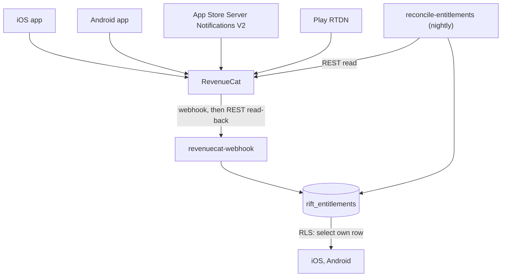

# Entitlements

How a purchase becomes access to **RiftTrades Pro**, and why the server owns the
answer.

## The one idea

A purchase is one way to **acquire** access. Access itself is a row in Postgres
keyed by Supabase `user_id` (`rift_entitlements`).

Buy on iOS, get Pro on Android. Refunds and lapses take access away by the same
path they granted it. A support question — "why does this person have Pro?" —
has one place to look.



## Tables

| Table | Holds | Written by |
| --- | --- | --- |
| `rift_entitlements` | One row per user: current access | Service role only |
| `rift_billing_events` | Raw provider events, keyed by event id | Service role only |

`rift_entitlements` has exactly one policy: `select` where `auth.uid() = user_id`.
No insert/update/delete for clients.

`rift_billing_events` has RLS enabled and **no** policies (service role only).

### Why one row of state

The webhook does not trust the event body for current access. It re-reads the
subscriber from RevenueCat and overwrites the row. That is idempotent: out-of-order
or repeated deliveries converge on the same answer. `rift_billing_events` is the
ledger for idempotency and disputes.

## The webhook

`supabase/functions/revenuecat-webhook`, in order:

1. Check the shared secret in `Authorization` (constant-time).
2. Record the event in `rift_billing_events` (replay → 200, no further work).
3. `GET /v1/subscribers/{app_user_id}` (with `X-Is-Sandbox: true` when needed).
4. Overwrite the `rift_entitlements` row; return 200.

Failures that should retry return 5xx. Unprocessable payloads return 2xx/4xx to
stop retries. If the entitlement write fails after recording the event, the
handler deletes that event before returning 500 so the retry is not treated as a
replay.

### Identity binding

The client calls `Purchases.logIn(supabaseUserId)` after Supabase sign-in, so
every webhook `app_user_id` **is** the Supabase UUID. Gate the paywall behind
sign-in — an anonymous purchase is manual support work to reattach.

`purchasesIdentityProvider` keeps binding current as sessions change; the paywall
**awaits** it before presenting. Sign-out must clear the binding so the next
account is not charged to the previous one.

## Nightly reconciliation

`supabase/functions/reconcile-entitlements`, scheduled by
`.github/workflows/reconcile-entitlements.yml` at 05:00 UTC.

Webhooks are the fast path. Expiry is often a non-event, and deliveries can
exhaust retries. Once a night, re-read subscribers whose `expires_at` falls in a
short window around now, and rewrite rows that actually changed.

## Configuration

```powershell
npx supabase secrets set `
  REVENUECAT_WEBHOOK_SECRET=<any long random string> `
  RECONCILE_SECRET=<a different long random string> `
  REVENUECAT_API_KEY=sk_<secret key from RevenueCat> `
  REVENUECAT_ENTITLEMENT_ID='RiftTrades Pro'

npx supabase functions deploy revenuecat-webhook
npx supabase functions deploy reconcile-entitlements
```

Both functions use `verify_jwt = false` in `supabase/config.toml` — RevenueCat
sends the shared secret, not a Supabase JWT.

Production webhook targets fabloodle
(`cnmxaccamqshgvesieez`). Staging uses a **separate sandbox-only webhook** on
the interim staging project (`tenrvaghaspwdvnwvgrh`) until fabtools is restored.
See [ENVIRONMENTS.md](ENVIRONMENTS.md).

| CI secret | Value |
| --- | --- |
| `SUPABASE_FUNCTIONS_URL` | `https://<project>.supabase.co/functions/v1` |
| `RECONCILE_SECRET` | Same as the Supabase secret |

## Reading entitlements on mobile

| Accessor | Sources |
| --- | --- |
| `entitlementProvider` → `isProProvider` | `CustomerInfo` + `rift_entitlements` |

Nothing else decides what "Pro" means. Mobile grants access when **either** source
says so. Use `entitlementResolvedProvider` before destructive free-tier trims so
an unknown state cannot delete data.

### Free-tier caps

Defined in `lib/core/logic/free_limits.dart`: binder 50, want list 25, loaned 25,
saved trades 3 (trim oldest). See [../context.md](../context.md).

### Pro-only features

| Feature | Gate |
| --- | --- |
| Find Trade Filler | `ensurePro` in `showTradeFillerSheet` |

## Debugging "I paid but I don't have Pro"

1. Confirm they are signed in with the same Supabase account used at purchase
   (`Purchases.logIn` binding).
2. RevenueCat customer: does the entitlement `RiftTrades Pro` show active?
3. `rift_entitlements` row for that `user_id`: `is_active`, `tier`, `expires_at`,
   `is_sandbox`, `source`.
4. `rift_billing_events` for the purchase event id — did the webhook 200?
5. Staging vs production: a sandbox buy against the staging project will never
   light up production Pro on fabloodle.
6. Force-close and relaunch (sync + entitlement refresh run on launch).
